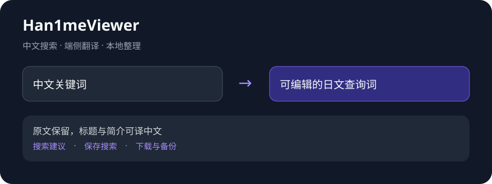

# 🔞 仅供成年用户试用

目前处于小规模测试阶段，请勿在不允许讨论成人工具的社区刷屏、搬运露骨素材或冒充内容网站官方。本仓库只分发应用代码和安装包，不分发视频。

# YoruShelf

🔞 R18 警告：未满 18 岁禁止下载和使用。

YoruShelf 是一个使用 Kotlin 开发的 Android 客户端，用于浏览、搜索、播放和管理相关公开视频页面内容。桌面名称和默认图标由本项目独立设计，仓库名及旧数据目录仍保留 Han1meViewer，以兼容既有文件和迁移资料。当前项目以 Jetpack Compose、Navigation Compose、ViewModel、StateFlow、Retrofit、Jsoup、Room、WorkManager、Media3/JZVD/MPV 为主要技术栈，围绕视频浏览、详情播放、搜索、用户列表、下载管理、评论、订阅、设置和隐私保护等功能组织。




本应用没有官方网站。正式版本通过[本仓库的 GitHub Releases](https://github.com/Yishiba/Han1meViewer/releases)分发和更新；首个自有 Release 尚未发布，页面为空时请勿从其他仓库下载安装包。

### 首批试用重点

1. 在搜索框输入中文或英文，点击旁边的翻译按钮，检查日文译词，必要时编辑后搜索。原词保留。
2. 在“设置 → 自动翻译”选择中文，观察首页标题、搜索结果和详情简介的翻译效果。
3. 试用下载管理、智能合集、备份或 WebDAV 同步；当前不设付费限制。

遇到问题请到[本仓库 Issues](https://github.com/Yishiba/Han1meViewer/issues)反馈；使用建议可到[Discussions](https://github.com/Yishiba/Han1meViewer/discussions)。反馈时请勿上传私密数据、账号 Cookie 或露骨截图。

## 📜 项目来源与许可

此项目最初 Fork 自 [YenalyLiew/Han1meViewer](https://github.com/YenalyLiew/Han1meViewer)，感谢原作者的贡献。原项目采用 [Apache License 2.0](https://www.apache.org/licenses/LICENSE-2.0)。

根据 Apache 2.0 许可证要求：

- 保留原版权声明。
- 包含许可证文件副本。
- 说明修改内容。

原始仓库：[YenalyLiew/Han1meViewer](https://github.com/YenalyLiew/Han1meViewer)

许可证文件：[LICENSE](LICENSE)

## ⚠️ 免责声明

本应用程序与 `https://hanime1.me/` 及其关联方无任何隶属、合作或授权关系。

🔍 数据来源：

- 本应用仅通过常规网络请求和 HTML DOM 解析获取目标网站公开显示的信息。
- 本应用不访问网站后端数据库。
- 本应用不进行注入攻击、绕过授权或获取非公开用户隐私数据。

⚖️ 使用限制：

- 本应用仅用于技术研究、学习交流和移动端体验优化。
- 本应用不提供商业化服务。
- 使用者应自行遵守所在地区法律法规和目标网站规则。

©️ 版权归属：

- 原始视频、图文和相关内容版权归 `https://hanime1.me/` 或原始制作、发行方所有。
- 本应用不存储版权内容，不修改原始内容，不声称拥有内容所有权。

🛡️ 责任豁免：

- 本应用不保证数据完整性、准确性和实时性。
- 使用本应用产生的一切后果由用户自行承担。
- 不得将本应用用于任何非法用途。

若 `https://hanime1.me/` 认为本应用行为不当，可通过 GitHub 仓库内置功能联系维护者。

🔄 最后更新日期：`2026-11-20`

ℹ️ 建议通过官方渠道支持原站内容，并点击广告以支持网站运营者。

## 💬 参与讨论

本 fork 的反馈入口是[Issues](https://github.com/Yishiba/Han1meViewer/issues)和[Discussions](https://github.com/Yishiba/Han1meViewer/discussions)。

## ✨ 功能概览

- 🏠 首页浏览：支持首页推荐、最新上传、分类入口、预览页和搜索入口。
- 🎬 视频详情：支持简介、作者、标签、系列视频、相关推荐、评论和子评论。
- ▶️ 视频播放：支持在线播放、本地下载文件播放、画中画、播放内核切换、倍速和画质选择。
- 🔍 搜索系统：支持关键词搜索、高级搜索、历史记录、筛选条件展示和分页加载。
- 🌐 搜索词翻译：搜索框旁点击翻译按钮，选择中文或英文，使用 ML Kit 在本机译成日文；原文保留，译文可编辑后搜索，暂不设付费或次数限制。
- 👤 用户内容：支持收藏、稍后观看、播放列表、在线历史、订阅作者和创作中心。
- 💬 评论系统：支持评论排序、回复查看、举报和复制分享文本。
- 📥 下载管理：支持后台下载、下载分组、导入本地文件、自定义下载目录和下载后播放。
- 🗂️ 本地媒体库：已下载页面支持关键词、排除词、分组、画质、大小和最近添加天数组合筛选，可保存、修改、重命名和删除自动更新的智能合集；当前不设付费限制。
- 💾 自动备份与多版本恢复：支持每日／每周本机备份、历史版本管理、恢复前保护副本及可选文件夹副本；当前不设付费限制。
- 🔐 账号能力：支持登录、手动录入 cookies、账号资料、头像裁剪、登录状态检测和退出登录。
- 🎨 主题与设置：支持 Material 3 主题、动态颜色、首页布局、播放设置、MPV 设置、下载设置和网络设置。
- 🕵️ 隐私保护：支持应用锁、启动器图标伪装和手动 Cookie 管理。
- 🌐 网络辅助：支持 Cloudflare 处理、备用域名、代理相关设置、CDN/网络检测和更新检查。
- 📅 健康打卡：内置冲了么打卡页面和桌面小组件。
- 🎯 共享关键 H 帧：支持内置关键帧数据读取、设置和共享数据展示。
- 🗞️ 公告系统：支持首页公告展示、公告详情弹窗，并配套 `HanimeAnnouncementManagerWebUI` 维护 Firebase Realtime Database 中的 `announcements` 节点。

### 搜索词翻译

输入关键词后，点击搜索框旁的翻译图标，在弹窗中选择原文语言并点击“开始翻译／重试”。首次使用需要联网下载所需语言模型（总量可能超过 80 MB，可能使用移动数据）；后续翻译在设备端执行。译文可编辑，确认后点击“搜索日文”，结果上方会显示实际查询词；也可以随时选择“搜索原文”或关闭弹窗。

翻译不会自动发起搜索，也不会覆盖搜索框中的原文。搜索请求仍会将实际查询词发送给内容网站。机器翻译不保证对应作品、角色或作者的正式名称；作品别名维护、标签匹配和多语言结果合并见下方“搜索与翻译增强”，暂不包含字幕翻译。模型下载失败时可重试，不影响普通搜索。ML Kit 翻译由 Google 提供，接入遵循其[使用指南](https://developers.google.com/ml-kit/language/translation/translation-terms)。

### 体验与价格研究（暂不收费）

“设置 → 体验与价格研究”展示 14 天体验观察期；新试用用户看到 ¥30/年的研究报价。旧版已记录的 ¥29／¥49 报价作为历史研究结果保留，不自动改写。报价只针对未来智能合集、自动整理、版本备份、跨设备同步等重度工具；高级下载任务并发也是候选权益，尚未启用收费限制。浏览、播放、普通下载、搜索及基础翻译作为免费基础版。
新安装用户首次成功加载首页后开始计时；升级前已确认使用须知的现有用户不进入本轮试用计时。
报价意向仅保存在本机，不自动上传，也不进入备份或设备迁移。当前所有功能继续免费开放；
观察期结束不会限制浏览、播放、搜索、翻译、媒体库或导出，不创建订阅和自动扣费。
该计时是研究展示，不是安全授权；本机时间可变，卸载后状态会丢失。
正式收费须先确认可受理当前产品的渠道、主体、定价及用户过渡政策，再设计服务端授权和支付回调；
不得将本轮意向回答当作真实购买。README 前述“本应用不提供商业化服务”仍适用于当前版本。

### 自动内容翻译

在“设置 → 自动翻译”或搜索页“自动翻译”中开启，默认关闭、目标语言默认为中文。
可选择 ML Kit 支持的英文、日文、韩文等目标语言。开启后，首页横幅、分类卡片、搜索结果的可见标题和详情页的
可见标题／简介会自动识别源语言并翻译；原文保留，译文单独显示并标注目标语言和机器翻译。
同语言内容跳过；无法识别、缺少模型或翻译失败时保留原文，提供重试和手动选择源语言的入口。
手动翻译也遵循当前目标语言，中英译日搜索保持原有功能。

语言识别模型随应用提供，识别和翻译均在本机进行；所需翻译模型仍需首次联网下载。
自动下载默认仅使用 Wi-Fi，明确开启“允许自动下载模型使用移动数据”后才允许移动数据下载。
模型齐备后可以离线翻译，原文和译文不会发给云翻译服务。关闭开关、离开页面、离屏或切换
目标语言会取消旧翻译任务；SDK 已启动的模型下载可能继续完成，但不会继续发布过期译文。

请求串行执行、缓存优先，并在进入队列后再次去重。缓存按原文、源语言模式、目标语言隔离，
沿用 150 条／1 MiB 限额，可在翻译工具中清理“内容翻译缓存”。自动开关和目标语言进入已有
设置备份，暂不加入 WebDAV 设置同步；移动数据许可单独存于本机配置，不随备份或系统迁移传播。所有能力不设付费限制。

依据：[语言识别](https://developers.google.com/ml-kit/language/identification/android)、
[端侧翻译](https://developers.google.com/ml-kit/language/translation/android)。

### 搜索联想、中文阅读与保存搜索

- **本地联想**：输入时展示个人别名、翻译历史、搜索历史、匹配标签和当前搜索结果中出现过的作者，显示来源并去重，最多 8 条。输入阶段不会联网；点击候选项才搜索，标签候选使用站点的标签键。这里没有公共作品名称数据库，不能保证所有中文俗称都能对应正式日文名。搜索后可点击“保存搜索别名”，编辑并保存常用名称与实际查询词；别名继续沿用既有备份和同步。
- **译中文**：搜索结果卡片、详情标题和简介提供按需翻译，支持日文／英文译为中文，保留原文并标注机器译文。点击开始后才允许首次模型下载（可能使用移动数据），之后在设备端翻译。相同原文与语言优先复用本机缓存，最多保留 150 条、1 MiB；在“翻译 → 搜索工具”中可清理内容翻译缓存，不删除语言模型或搜索别名。单段最多 5000 字符，超长文本明确提示，不静默截断；失败可重试、关闭可取消。
- **保存搜索**：完成一次成功搜索后保存当次实际执行的完整条件，包括中日文合并查询、类型、排序、宽泛匹配、日期、时长、标签、厂商和站点。点击“已保存与更新”可重命名、暂停／恢复、删除或重新搜索。重新搜索恢复保存条件，不使用当前搜索框中尚未提交的编辑内容。
- **更新列表**：启动应用时检查距上次检查超过 6 小时的已启用搜索，一次启动最多检查最久未检查的 10 项，前台启动检查最多执行 2 分钟；列表内可手动检查全部（最多 50 项）。只检查每个查询的第一页，第一次成功仅建立基线；之后按影片编号展示新发现的匹配结果，不保证是首次上传，也不保证发现所有更新。点击影片会标为已读，也可全部标为已读。每项保留最近 200 条发现、最多 5000 个已见编号；已见编号达到容量后停止该项新增检查并提示失败，不丢弃去重信息。网络、登录、验证或站点不匹配时保留原记录，检查不会主动打开验证窗口；可先在普通搜索中完成站点验证。保存搜索绑定原站点，切换站点后不向新站点发送原条件。
- **数据范围**：上述能力全部无付费限制。保存搜索与发现记录暂仅保存在本机，不进入现有备份、WebDAV 同步或 Android 自动备份；卸载／清除数据会删除。中文翻译缓存也不备份或同步；既有搜索别名、翻译历史的备份和同步保持原行为。最多保存 50 项搜索，属于本机容量边界。

### 本地媒体库与智能合集

进入“下载 → 已下载”，可直接按标题或影片编号搜索。点击“筛选与合集”组合设置包含／排除关键词、多个分组、多个画质、文件大小上下限（MiB，1 MiB = 1024² 字节）、最近添加天数及排序。不同字段需同时满足；同一字段内的多个分组或画质只需匹配任一个。留空或不选表示不限。大小是下载元数据中的文件字节数，不是影片时长；日期是添加下载记录的时间。

“应用筛选”只临时使用条件；填写唯一名称后“保存合集”会保存规则和排序，合集会随新增下载、分组变动和时间推移自动重算（相对日期在页面可见时每分钟刷新）。选中合集再次进入编辑可修改规则和名称；删除合集只删除规则，不删除影片、下载记录或原分组。“全部下载”或“重置”恢复原来的分组视图；自定义筛选和合集使用扁平结果以保证全局排序。

规则仅保存在本地设置，随数据备份导出／恢复，不上传服务器，也不复制视频。已经删除的分组或缺失画质不会自动变成“无限制”；无法读取的规则会保留原数据并禁用覆盖保存，临时筛选仍可用。切换筛选会清空旧选择，批量操作只使用当前可见结果；删除视频只删除选中的视频文件，保留可能被其他画质共享的封面和元数据。权限失效或文件已移动导致删除失败时，对应下载记录保留。

### 规则自动整理与媒体库检查

- **自动整理**：在已保存合集的编辑界面打开“自动整理新下载”，选择一个非“未分组”的现有目标分组后保存。合集列表顺序即规则优先级，可在“规则整理”中上下移动或启停；首条匹配且目标有效的规则生效。只修改记录所属分组，不移动磁盘文件，只处理未分组的已完成下载；下载完成的后台流程会直接应用规则，无需打开下载页。重复完成回调不会重整已有完成记录或覆盖手动分组。删除目标分组后该规则跳过，规则损坏时保留下载的完成状态与当前分组。
- **现有下载**：“规则整理 → 预览现有下载”列出本次拟归组的记录，点击“确认整理”才写入；确认时重新核实规则与记录。旧预览失效时整批不执行，也不把预览之后的新下载偷偷加入操作范围。
- **媒体库检查**：在“已下载 → 媒体库检查”手动启动，支持取消和重新检查。只读取已完成记录指向的文件，不扫描其他目录、不上传报告。先读取实际大小，同大小的独立文件再完整计算 SHA-256，摘要和大小都一致才报告内容重复；同一文件的重复引用单独显示，并禁止直接物理删除共享文件。大文件阈值可调整，按实际大小降序展示；未知大小不参加内容重复及大文件判断。空文件和检查期间变化的文件单独标记。
- **失效与权限**：本地文件确认不存在才显示“文件确认缺失”。文档 URI 不可读、授权失效、存储卷不可用等显示“暂不可读”，不据此移除记录。移除确认缺失的记录前会重新检查当前 URI、记录状态和文件是否仍然缺失，只删记录，不删文件。报告期间下载记录变化后，旧结果操作停用，需重新检查。
- **操作保护**：报告可播放核对，通过确认流程删除独立视频文件；实际删除前重新核实当前记录及共享引用。另一条记录仍引用同一文件时不物理删除。所有这些能力暂不设付费限制；规则设置随现有设置备份恢复，检查报告仅保留在内存中。

### 自动备份与多版本恢复

进入“设置 → 自动备份与历史版本”，可立即创建备份，或开启每日／每周自动备份（默认关闭）。后台任务由 Android WorkManager 在电量不低时调度，首次符合条件即可执行，后续时间可能因休眠、强制停止或系统省电而延后，并非固定时刻提醒。可保留最近 3、7、14、30 个普通版本，另保留最近一次恢复前的保护版本；只有新版本写入并读回校验成功后才清理旧普通版本。

备份包含搜索别名和翻译历史、设置、智能合集及自动整理规则、下载分组与分类和下载记录、观看历史、关键帧、打卡记录与配菜。视频、封面等媒体文件及系统下载任务本身不在备份内；恢复未完成的下载记录时统一置为暂停，需要用户手动继续。登录 Cookie、Cloudflare Cookie、登录标记和保存的用户 ID 不导出，恢复时保留本机当前账号与使用须知确认状态。既有损坏的合集设置也会原样保留在保护副本中，以便从可用的旧版恢复；合集读取失败仍由媒体库显示原有错误状态。

本机版本保存在应用私有的 `noBackupFilesDir/backup-versions`，清理缓存不会删除，但卸载或清除应用数据会删除。可以额外选择系统文件夹，每次手动／自动备份都复制一份校验后的普通或加密文件；副本失败会提示，本机版本仍保留。外部副本不参与本机保留数量限制，也不会随本机版本删除，可通过已有“导入备份”恢复。普通 JSON 包含可直接读取的个人记录；建议启用副本密码加密。自动备份频率、保留数量、文件夹授权及备份状态属于设备本机配置，不随旧备份恢复或系统迁移。

版本列表支持选定版本导出、删除普通版本和确认后恢复。恢复前校验大小、格式版本、SHA-256 与记录关系，再建立当前数据的保护版本；写入失败会尝试回滚。多套 Room 数据库各自使用事务，跨库恢复由持久化恢复日志保护：进程中断后，下次启动先恢复到操作前状态，恢复失败则显示重试界面并暂停媒体库和下载操作。存在正在运行、等待调度或排队中的下载时拒绝恢复，需先暂停并等待任务结束。恢复前保护版本不能手动删除，可像普通版本一样导出或恢复。原有 v1 JSON 文件仍支持导入，新导出文件使用带校验信息的封装格式，旧版应用不保证能够读取。

## 🗞️ 公告系统使用须知

公告系统分为两部分：

- 用户侧：应用启动后由 `MainViewModel.loadAnnouncements()` 从 Firebase Realtime Database 读取 `announcements` 节点，首页会展示有效公告，并可点开公告详情弹窗。
- 维护侧：`HanimeAnnouncementManagerWebUI` 用于维护公告数据，负责向同一个 `announcements` 节点写入、更新或下线公告。

`HanimeAnnouncementManagerWebUI` 目录包含两个文件：

- `HanimeAnnouncementManager.html`：公告管理网页，用于增删改查公告、切换启用状态。
- `PermitAdmin.py`：给 Firebase Auth 用户写入 `isAdmin` 自定义声明，用于控制谁能访问管理端。

前置条件：

- 应用必须能够正常访问网络。
- 项目中配置的 Firebase Realtime Database 地址必须可用。
- `announcements` 节点下的公告数据结构需要和 `Announcement` 模型一致，至少包含 `title`、`content`、`isActive` 等字段。
- 公告内容会按 `priority` 排序，只有 `isActive = true` 的公告才会显示。
- 管理端需要启用 Firebase Authentication 和 Realtime Database。
- 管理端需要准备 Firebase Web 配置参数和可登录的管理员邮箱、密码。
- 若使用 `PermitAdmin.py`，还需要 Firebase Admin SDK 的 `serviceAccountKey.json`。

使用规则：

- 首页公告默认会展示为有效公告列表。
- 用户关闭公告后，会记录 `last_dismiss_time`，24 小时内不会再次自动弹出。
- 公告详情支持标题、内容、发布时间、图片和按钮文案。
- 若公告配置了链接，内容中可直接展示可点击的 URL。

管理端使用步骤：

1. 在 `HanimeAnnouncementManager.html` 中填写 `firebaseConfig`。
2. 在 `ADMIN_EMAIL` 和 `ADMIN_PASSWORD` 中填入可登录 Firebase Auth 的管理员账号。
3. 确保 Realtime Database 规则允许该管理员账号读写 `announcements` 节点。
4. 如需批量授权管理员，先安装 `firebase-admin`，准备 `serviceAccountKey.json`，再运行 `PermitAdmin.py` 并填写目标用户 UID。
5. 打开管理页后即可新增、编辑、启用、停用或删除公告。

公告字段说明：

- `title`：公告标题。
- `content`：公告正文。
- `imageUrl`：公告图片地址，可选。
- `positiveText`：确认按钮文案，可选。
- `negativeText`：取消按钮文案，可选。
- `priority`：排序优先级。
- `timestamp`：公告时间戳，单位为秒。
- `isActive`：是否启用。

维护建议：

- 新公告建议先在 WebUI 中预览，再切换为 `isActive = true`。
- 过期或不再需要显示的公告应直接下线，而不是删除，以便回溯。
- 重要公告优先级数值应更高或更低需与 WebUI 约定保持一致，避免排序混乱。

## 📷 截图预览

 

 

 


## 🧱 当前架构

📦 项目采用多模块 Gradle 结构：

- `:app`：主应用模块，包含界面、导航、业务 ViewModel、网络解析、数据库、下载 Worker、播放器和资源文件。
- `:yenaly_libs`：项目内公共基础库，封装通用 Activity、Fragment、ViewModel、偏好设置、工具类和基础组件。
- `buildSrc`：构建配置辅助代码，用于版本号、构建类型和提交信息等 Gradle 逻辑。

🗂️ 主应用采用分层组织：

- `ui.activity`：入口 Activity、登录、Cloudflare 处理和手动 Cookie 输入页面。
- `ui.navigation`：Navigation Compose 路由定义、主导航、设置导航和安全跳转封装。
- `ui.screen`：Compose 页面实现，按首页、搜索、视频、设置、账号、下载等业务域划分。
- `ui.component`：可复用 Compose 组件，如视频卡片、弹窗、空/错/加载状态、AppBar、评论卡片等。
- `ui.viewmodel`：页面状态和业务动作入口，主要通过 `StateFlow` / `SharedFlow` 对 UI 暴露状态。
- `logic.network`：Retrofit Service、OkHttp 拦截器、DNS、CookieJar、更新服务和网络入口。
- `logic.model`：页面和网络解析后的领域模型，如 `HanimeVideo`、`HanimeInfo`、`HomePage`、`Playlists` 等。
- `logic.dao` / `logic.entity`：Room 数据库、DAO 和实体，用于历史、下载、搜索历史、关键帧、打卡等本地数据。
- `announcement` 链路：公告数据从 Firebase Realtime Database 的 `announcements` 节点读取，首页通过 `MainViewModel.loadAnnouncements()` 拉取并展示，管理端使用 `HanimeAnnouncementManagerWebUI` 维护公告内容。
- `worker`：WorkManager 下载任务和更新任务。
- `util`：主题、网络、文件、权限、Cookie、Toast、视频和通用工具方法。

🔁 整体数据流：

```text
Compose Screen -> ViewModel -> NetworkRepo / DatabaseRepo -> Retrofit + Jsoup / Room -> StateFlow -> Compose Screen
```

🎞️ 视频页数据流：

```text
VideoRoute -> VideoViewModel -> NetworkRepo.getHanimeVideo -> Parser -> HanimeVideo -> VideoScreen / Player / CommentScreen
```

📥 下载数据流：

```text
DownloadScreen -> DownloadViewModel -> HanimeDownloadManagerV2 -> WorkManager Worker -> Room -> Flow -> UI
```

## 🛠️ 技术栈

- Kotlin 2.3.x
- Java 21 toolchain
- Android Gradle Plugin 9.2.x
- Jetpack Compose + Material 3
- Navigation Compose + Kotlin Serialization typed routes
- ViewModel + StateFlow + SharedFlow
- Retrofit 3 + kotlinx.serialization converter
- Jsoup HTML 解析
- Room + KSP
- WorkManager 后台任务
- Coil 3 Compose 图片加载
- Media3 ExoPlayer、JZVD、MPV Android
- Firebase Analytics、Crashlytics、Performance、Remote Config、Realtime Database
- AndroidX Window、Biometric、SplashScreen、Preference
- AboutLibraries 开源许可展示

## 🧰 构建环境

✅ 推荐环境：

- Android Studio Panda 或更新版本。
- JDK 21。
- Gradle Wrapper 使用仓库内置版本。
- 编译 SDK：`37`。
- 最低支持：Android 8.1，API `27`。
- 目标 SDK：`37`。

📌 关键版本以仓库文件为准：

- `gradle.properties`
- `gradle/libs.versions.toml`
- `app/build.gradle.kts`
- `buildSrc/src/main/java/Config.kt`

## 🚀 本地运行

1. 克隆项目：

   ```bash
   git clone https://github.com/Yishiba/Han1meViewer.git
   ```

2. 使用 Android Studio 打开项目根目录。

3. 等待 Gradle Sync 完成。

4. 选择 `debug` 变体运行到设备或模拟器。

💻 常用命令：

```bash
./gradlew :app:compileDebugKotlin
./gradlew :app:assembleDebug
```

🪟 Windows PowerShell：

```powershell
.\gradlew.bat :app:compileDebugKotlin
.\gradlew.bat :app:assembleDebug
```

🔏 独立包名为 `io.github.yishiba.han1meviewer`（Debug 追加 `.debug`）。本机签名脚本为 `bash scripts/build-release-local.sh`；Android 8.1+ 均只使用自有正式证书。新包可与旧 `com.yenaly.han1meviewer` 并存，系统不会自动迁移数据；先在旧包导出备份，再到新包恢复，视频文件和登录 Cookie 需单独处理。签名私钥只在本机及个人加密备份中，密码存于钥匙串或跨设备密码管理器。

🔑 应用通过 GitHub 公共 Release API 检查更新，构建和安装包不需要 GitHub API Token。CI 构建产物不再提供应用内更新；同一包名的后续覆盖安装须保持签名和更高的 `versionCode`。旧包名的发行候选版仍是未公开草稿，不作为新包的更新源。

### 默认 DNS 配置

新安装默认启用 Google Public DNS 的 DoH（`https://dns.google/dns-query`），并使用
`8.8.8.8`、`8.8.4.4` 引导连接，避免 DoH 服务本身依赖系统 DNS 解析。
这是对部分网络下系统 DNS 返回异常地址、首页连接超时的修复；网站 IP 仍动态解析。
端点与引导地址依据 [Google Public DNS 文档](https://developers.google.com/speed/public-dns/docs/doh/migration)。

未保存过 DoH 开关的用户会使用新默认值；已明确关闭 DoH、选择其他预设或设置自定义 DNS
的用户保持原设置。已启用内置 Hosts 的用户不会被默认开启 DoH。
可在「设置 → 网络设置 → 使用 DoH」调整。DoH 失败时沿用系统 DNS 回退；
此修复不能保证所有网络或站点验证场景均可访问。

## ✅ 代码约定

- UI 优先使用 Jetpack Compose，少量历史页面和组件仍保留 XML / ViewBinding / DataBinding。
- 页面状态通过 `StateFlow` 暴露，事件通过 `SharedFlow` 或回调传递。
- 网络页面列表追加时应按稳定业务键去重，避免 Compose `Lazy*` 列表 key 冲突。
- `LazyColumn`、`LazyVerticalGrid`、`LazyRow` 使用稳定 key 时应确保数据源唯一。

## 🗺️ 目录速查

```text
Han1meViewer/
├── app/                         主 Android 应用
│   ├── src/main/java/.../logic   网络、解析、模型、数据库、状态
│   ├── src/main/java/.../ui      Activity、Compose 页面、导航、组件、ViewModel
│   ├── src/main/java/.../util    通用工具
│   ├── src/main/java/.../worker  WorkManager 任务
│   └── src/main/res              资源文件、主题、布局、图标、小组件
├── yenaly_libs/                  项目内公共库
├── buildSrc/                     Gradle 构建辅助代码
├── gradle/libs.versions.toml     依赖版本目录
├── README.md                     项目说明
└── README_TECH.md                历史技术说明与部分实现笔记
```

## 🤝 贡献说明

- 提交代码前请先确认可以通过 `:app:compileDebugKotlin`。
- 修改网络列表、分页或 Compose `Lazy*` 列表时，请检查重复 key 风险。
- 修改播放、下载、账号、Cookie、Cloudflare、更新逻辑时，请尽量说明验证方式。
- 提交共享关键 H 帧可参考 `.github/PULL_REQUEST_TEMPLATE/submit_h_keyframe.md`。

## 🧩 TODO

- 随时有想法随时写。

## 📄 许可证

Android 客户端继续在本公开仓库开发。付款核验与授权服务今后在独立私有仓库维护；客户端仅包含公开 API 协议与验签公钥，不包含收款凭据或签名私钥。当前仍未开通真实付款或 Pro 拦截。

本项目继承原始项目的 [Apache License 2.0](https://www.apache.org/licenses/LICENSE-2.0)。主要条款包括：

- 允许商用、修改和分发。
- 要求保留版权声明和许可证文件。
- 要求提供修改说明。
- 不提供质量担保。
- 不承担用户使用风险。

完整条款请参阅项目根目录下的 [LICENSE](LICENSE) 文件。

### 搜索与翻译增强

翻译弹窗自动按文字脚本初选中文／英文（不是通用语言识别，含假名或只有数字时需手选）。完整关键词匹配现有标签的简中、繁中、英文、日文名称后，可确认使用站点原始标签键；不会静默改写关键词。通过“翻译历史、别名与模型”维护个人作品别名、复用相同原文的历史译文，并查看、下载或删除中英日模型。别名由用户验证，未内置未经核实的作品名词典。历史仅在使用译文搜索时记录最近 50 条，可单条删除或清空；别名最多 200 条。两者保存在本机独立存储，并纳入普通／加密备份及配置后的 WebDAV 加密同步；启用后台同步后会自动发送这些记录。卸载或清除应用数据仍会删除本机数据。

译文可以编辑，也可明确选择合并原文与日文搜索；两路沿用相同高级条件，分别分页，按视频编号去重。部分请求失败时保留已成功的结果，可重试失败页；合并结果按查询先后拼接，不承诺跨查询的全局相关性排序。模型管理与翻译互斥，避免使用过程中删除共用模型。模型下载可能使用移动数据，删除后翻译需要重新下载。所有增强功能暂不设付费限制。

### 跨设备同步与 NAS／WebDAV

入口：“设置 → 跨设备同步与 NAS”。配置现有 HTTPS WebDAV 文件夹、用户名和密码，点击“连接并保存”后可浏览目录、返回上层、刷新和播放常见视频文件。NAS 需要开启 WebDAV 服务；本版本只接入 HTTPS WebDAV 和 Basic 认证，不包含 SMB／NFS、网络文件删除或上传视频。使用系统证书校验，不跳过 TLS 验证；重定向被拒绝，需填写最终 WebDAV 地址。列表限制为当前目录的直接子项，站外、越界、编码斜杠及嵌套编码路径不会被使用。目录元数据目前要求 UTF-8 XML，拒绝 DTD、外部实体及超限响应。目录响应遵循 [WebDAV PROPFIND](https://www.rfc-editor.org/rfc/rfc4918.html)。

网络视频使用独立 Media3 播放器，通过同一受限认证客户端读取 Range 数据，支持暂停、拖动和恢复进度。连接密码不会放进播放 URL，也不传给外部播放器，不复用网站 Cookie 或网站网络拦截器，并直接连接 WebDAV，不经过应用的站点 HTTP／SOCKS 代理（系统 VPN 路由仍由系统决定）。专用远端模块按 [Firebase 官方的类排除方式](https://firebase.google.com/docs/perf-mon/troubleshooting?platform=android)排除自动性能插桩，避免私人 NAS URL 进入 Firebase 网络性能指标。跨主机重定向和目录外媒体请求会拒绝；HLS 的分片和密钥也必须位于配置的同一目录边界内。播放进度每十秒及暂停／关闭时保存；目录、网络、服务器范围读取与编码格式仍影响实际播放能力。

所有设备配置同一 WebDAV 文件夹和 12～256 字符的共享同步口令后，可手动“预览同步变更 → 确认同步”。无需新增应用账号，不依赖项目 Firebase 服务。同步范围为搜索别名和翻译历史、网站观看历史和进度、智能合集及规则优先级／自动整理设置、WebDAV 播放进度，以及主题色、明暗模式、视频语言、默认画质、已观看标记、续播和评论开关。登录 Cookie、应用锁、设备路径、下载任务和视频文件不参与同步。分组以名称传递，在目标设备映射到本机 ID，缺少的分组会创建；同名分组存在歧义时拒绝应用。同名合集使用不同 ID 时保留两项并给重名项加数字后缀。不会移动磁盘文件。

手动同步采用用户确认的双向合并；也可按下方说明显式启用后台自动同步。同步使用逻辑版本与设备 ID、上次同步基准及删除标记；未修改的旧设备不会复活已同步删除的记录。冲突数量在预览显示，可选择优先远端或本机。首次同步也会将两端已有的不同值视作冲突。同步文档保留删除标记，最多 20000 个字段，不自动压缩历史删除记录。同步文件固定为所选目录下的 `.han1me-sync-v1.json`，建议使用专用文件夹。

文档以共享口令派生密钥（PBKDF2-HMAC-SHA256，210000 次）并用 AES-256-GCM 加密。口令遗失不能恢复远端内容。连接配置、口令、网络播放进度及同步基准使用 Android Keystore 加密，保存在 `noBackupFilesDir/remote-library.bin`，不随手动备份或系统迁移导出，卸载或清除应用数据后需重新配置。移除连接只删除本机这部分数据，不删除远端文档或影片。

远端读取要求强 ETag，发布使用 [If-Match／If-None-Match](https://www.rfc-editor.org/rfc/rfc9110.html#name-if-match) 防止覆盖预览之后的变更；服务器需正确实现条件写入。冲突时重新预览，不强行覆盖。本机应用前检查预览是否过期，并复用备份模块的下载互斥、保护版本、跨库恢复日志与回滚。同步成功路径只插入缺少的分组、更新允许的设置及观看记录，不替换已有分组或下载记录，保留本机失败／暂停状态；若需恢复保护版本，未完成下载仍遵循原有备份恢复规则置为暂停。存在运行或排队下载时需先暂停。本机数据库与远端服务器无法组成单个事务：若远端发布成功后本机写入失败，远端可能已更新，本机受保护备份保护，重新预览再同步即可；不会以失败为由删除远端文档。本机设置同步后重新打开界面生效。当前全部能力不设付费限制。

自动化验证使用合成的本地 HTTPS WebDAV 服务和两个隔离的设备状态，测试证书及其私钥仅作为测试资源，不进入生产信任配置。真实 NAS 的认证、证书、Range 和 WebDAV 条件写入兼容性仍需用实际设备验证。

### 加密备份（暂不限制付费）

设置中的“导出备份”和历史版本“导出”默认选择密码加密，需输入并确认 12–256 个字符的密码。生成 `.hvbenc` 文件，也可明确选择普通 JSON。一次性导出密码仅用于本次操作，不保存；直接导出当前数据不额外触发文件夹副本。导入自动识别加密文件，输入密码后才校验并进入原有保护恢复流程。密码错误、认证失败或文件损坏不会写入现有数据。旧版普通 JSON 仍兼容。

在“自动备份和版本”中可为文件夹副本单独设置或更换密码，对今后手动创建及自动创建的外部副本生效。此密码由 Android Keystore 加密保存在 `noBackupFilesDir/backup-copy-password.bin`，不随备份导出或系统迁移。密钥不可用时只报告副本失败并保留本机版本，不会退回明文副本。更换或关闭密码不会转换已有文件；旧加密文件仍需要原密码。忘记密码无法解密，卸载后需重新配置自动副本密码。

使用 AES-256-GCM、随机 16 字节盐和 12 字节 IV；PBKDF2-HMAC-SHA256 固定 600000 次派生，格式版本及算法信息参加认证。导入限制文件体积并先验证固定参数，避免任意派生参数。密码输入窗口禁止截屏，密码不写入 Activity 保存状态。本机历史和恢复保护版本仍在应用私有目录中，不以用户密码加密，以支持无人值守备份及启动回滚。本功能不加密视频或媒体库文件。

加密格式使用独立 Python cryptography 生成的中日文参考文件，同时在 JVM 与 Android 上验证，避免仅用同一实现自证读写互通。算法参数参考 [OWASP PBKDF2 指引](https://cheatsheetseries.owasp.org/cheatsheets/Password_Storage_Cheat_Sheet.html#pbkdf2)，本机密钥使用 [Android Keystore GCM](https://developer.android.com/reference/android/security/keystore/KeyGenParameterSpec)。

本批验证：`:app:testDebugUnitTest` 59 项通过；API 36 专用模拟器运行 `com.yenaly.han1meviewer.ui.screen` 包的 45 项设备／界面用例全部通过，覆盖密码重试、加密副本、密钥损坏拒绝明文回退、恢复回滚、版本列表操作以及既有媒体库／搜索翻译／WebDAV 同步回归。Debug APK 构建通过，预编译后的独立冷启动约 1.5 秒；首次安装在该模拟器曾因 Firebase 初始化触发启动超时，预编译后未复现。

### 后台自动同步与搜索数据迁移（暂不限制付费）

“设置 → 跨设备同步与 NAS”保存带共享口令的 WebDAV 后，可打开后台自动同步。默认关闭、仅非计费网络，可选 15 分钟、1 小时、6 小时；Android WorkManager 要求网络可用且电量不低，首次安排在选定间隔之后，休眠、省电、强制停止和网络均可延后执行，并非实时推送或精确计时。应用启动恢复调度；保存连接或忘记连接会关闭自动同步并取消后续任务。关闭时已经发出的请求可能完成，不承诺撤销远端已接受的写入。

后台与手动同步共用互斥、加密、条件 ETag 写入和恢复保护。无变化时只检查，不重写远端文档或创建保护版本。冲突时不上传、不应用，显示暂停原因，手动预览并确认成功后恢复；认证、口令、证书、数据格式或存储异常会暂停。下载占用、本机修改、网络或远端版本变化可退避重试，单轮最多额外重试 3 次，再等待下个周期。界面显示最近尝试、最近成功及状态，不保存私人 URL、查询或凭据的异常详情。调度控制、状态和授权属于本机配置，排除在手动备份和系统迁移之外。

备份数据升为 v3，搜索别名和翻译历史纳入普通 JSON、密码加密导出、自动副本及恢复保护。旧 v1/v2 备份缺少搜索字段时保留本机当前搜索数据；明确的空搜索数据则清空。损坏的本机搜索目录可以原文保存在保护版本中，仍能恢复已知可用版本；损坏目录不参与同步。恢复或同步应用期间，搜索编辑等待保护流程结束，避免覆盖新修改。

同步数据升为 v2，沿用原有 `.han1me-sync-v1.json` 位置并兼容旧 v1 文档；所有设备须升级，旧客户端会拒绝新版文档。别名按规范化原文逐条同步（最多 200 条），独立新增可合并，同条不同修改属于冲突；合并超量则拒绝写入而非丢弃别名。翻译历史按原文和译文组合逐条同步，记录使用时间，按最近时间保留 50 条；清空、删除及淘汰都产生删除标记，防止旧设备复活旧记录。旧本机历史缺少时间时按既有顺序迁移，排序受设备时钟影响。沿用 20000 字段（含删除标记）上限，不自动压缩删除历史。

调度依据 [Android WorkManager 周期任务与约束](https://developer.android.com/develop/background-work/background-tasks/persistent/getting-started/define-work)。本批不增加付费限制、视频文件同步、字幕翻译或媒体库加密。

同一原文与译文在两台设备重复使用时，仅合并较新的使用时间，不计为内容冲突；删除与重新使用并发时仍需手动确认。手动同步成功会更新后台任务的授权代次，避免旧任务的结果重新覆盖成功状态。

本批最终验证：Debug 应用和测试 APK 构建成功，65 项应用单元测试通过；API 36 专用模拟器执行 `com.yenaly.han1meviewer.ui.screen` 包的 61 项设备／界面用例全部通过。覆盖实际设置开关和间隔修改、WorkManager 执行与取消、双端 HTTPS 加密同步、冲突暂停和恢复、历史淘汰与删除传播、重复使用时间合并、旧备份兼容、搜索数据回滚、并发编辑及既有功能回归；最终界面截图已检查。测试使用本地合成 HTTPS WebDAV 服务及隔离设备状态，不代表所有真实 NAS 已通过兼容性验证。
